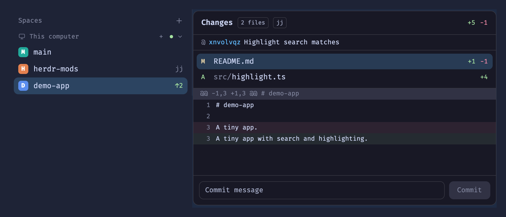

# Jujutsu for Herdr.app

[Jujutsu (jj)](https://jj-vcs.github.io/jj/) support for [Herdr.app](https://herdr.dev):

- **`jj-changes`**: the Changes panel, jj-aware. In a jj repo (colocated or not) it lists the working-copy change `@` against its parent with +/- counts, shows each file's diff, and its **Commit** button runs `jj commit -m`. A header row shows `@ <change id> · <description>` and a `conflict` badge. Anywhere else it is the shipped git panel, unchanged.
- **`jj-menu`** + **`jj-workspace`**: right-click a space in a jj repo for **New jj workspace**, **Open jj workspace** and (in an added one) **Remove jj workspace**, in place of git's worktree items. They put workspaces where Herdr puts worktrees (`~/.herdr/worktrees/<repo>/<name>`) and nest their spaces under the repo. Git repos keep the worktree items.
- **`spaces-icons.patch`**: the left bar. Instead of git's `detached`, a jj repo's space shows its nearest local bookmark and `↑N` (non-empty changes since it), or `@<change id>` when no bookmark is below `@`. Written for a `spaces` clone (`spaces-icons`); the same `check()` / `checkJj()` change applies to any clone of the shipped `spaces`.



## Install

With Herdr.app open, ask the agent in your Herdr window: *"add the mod at github.com/sebcbi1/herdr-app-jj"*. It follows [RECIPE.md](RECIPE.md) → *Installing into someone's setup*. That copies the mods, points your layout's Changes block at `jj-changes` (cloning a shipped layout first), and patches your sidebar mod (cloning the shipped `spaces` first).

Or by hand:

```sh
cp -R mods/jj-changes ~/.config/herdr-app/mods/
herdr-app check ~/.config/herdr-app/mods/jj-changes
```

Copy, don't symlink: Herdr.app doesn't hot-reload a symlinked mod folder.

### Layout change (required for the panel)

Installing the mod doesn't show it anywhere: a layout picks which mod each block shows, and the shipped `changes` mod can't be replaced (Herdr restores shipped mods on every start). Point your layout's Changes block at `jj-changes`, in `~/.config/herdr-app/layouts/<your-layout>.json` (the shown one is `"layout"` in `herdr-app status`):

```diff
 { "id": "changes", "type": "block",
-  "content": { "mod": "changes" } }
+  "content": { "mod": "jj-changes" } }
```

- Keep the block id `changes`: the tab bar's **Changes** button opens the node by that id.
- Do it in every layout you use. Shipped layouts (`main`, `terminals`, `win98`) are read-only: clone one first (`herdr-app do layout.clone '{"name":"main","as":"my-layout"}'`, which also switches to it), then edit the clone.
- Undo: put `"changes"` back.

### Workspaces menu

```sh
cp -R mods/jj-menu mods/jj-workspace ~/.config/herdr-app/mods/
```

The sidebar decides which menu a right-click opens: the patch below makes it `jj-menu`. `herdr-app do mod.open '{"name":"jj-workspace"}'` (bindable in keys.json) opens the workspace list for the shown space.

### Left bar

The left bar gets a code change to your own clone of `spaces`. The same patch switches its right-click menu to `jj-menu`. If your layout still shows the shipped `spaces`, clone it first (`herdr-app do mod.clone '{"name":"spaces","as":"spaces-jj"}'`). Then point the layout's `spaces` block at the clone; that is the only layout change this step needs.

```sh
patch ~/.config/herdr-app/mods/<your-spaces-clone>/main.js < spaces-icons.patch
```

On a fresh clone of the shipped `spaces`, two of the five hunks fail. Add `readTextFile` to its `from "herdr"` import yourself, and skip the `roots()` hunk, which is only for clones with project icons. RECIPE.md → *Installing into someone's setup* step 3 has the details.

## How it works

- jj is tried first (`jj root`); no jj on that machine or not a jj repo → git, as shipped. Remote machines (`exec … {on}`) work the same way.
- File list: one `jj log -r @ -T …` with `self.diff().stat().files()` (status, lines added/removed, path). It snapshots the working copy, so new edits appear.
- Diff: `jj diff --git -r @ -- root-file:"<path>"`.
- Every jj call writes under `.jj/` (and `.git/` when colocated). Watch batches made only of those, within 2 s of the panel's own jj call, are ignored, so the panel doesn't refresh itself in a loop. Ops from elsewhere (`jj new`, `jj squash` in a terminal) still refresh it.
- Workspaces:
  - **New** runs `jj workspace add --name <name> [-r "<bookmark>"] <path>` from the space's own workspace. A name that is a local bookmark starts the new change on it; the bookmark doesn't move.
  - **Open** reads `jj workspace list` (folders deleted by hand show "folder missing") and runs `jj workspace update-stale` before switching.
  - **Remove** closes the space, then runs `jj workspace remove` from the main workspace: jj snapshots the edits into a commit before deleting the folder, and refuses the workspace that holds the repo. Ignored files (`.env`, build output) go with the folder. In a colocated repo jj also adds and removes the matching git worktree.
- The left bar uses `--ignore-working-copy` (no snapshot, no writes). It watches `.jj/repo`.

## Limits

- Requires jj ≥ 0.33-ish (`DiffStatEntry` templates); tested with 0.47.1.
- Renames show under the new path only.
- The panel snapshots the working copy on each refresh (every 10 s and on file changes), like running `jj st`. If that lands mid-way through a `jj describe`/`squash` in a terminal, jj merges the two operations; rarely, `@` can end up divergent.
- A jj op run in a terminal within 2 s of the panel's own refresh is taken for its echo. The list then catches up on the next 10 s tick.
- The sidebar doesn't snapshot, so `↑N` ignores edits not yet snapshotted, and plain `git` ops in a colocated repo show after the next jj command.
- A git repo nested inside a jj workspace shows the outer jj repo.
- The tab bar's **+** menu (shipped `new-menu`) still offers git worktrees: it is opened by the tab bar mod, so changing it would mean patching that too. Use the space right-click menu, or `mod.open jj-workspace`.
- The bottom status bar (shipped `workspace-status`) still uses the core's git branch, empty in a colocated jj repo.

## License

MIT
