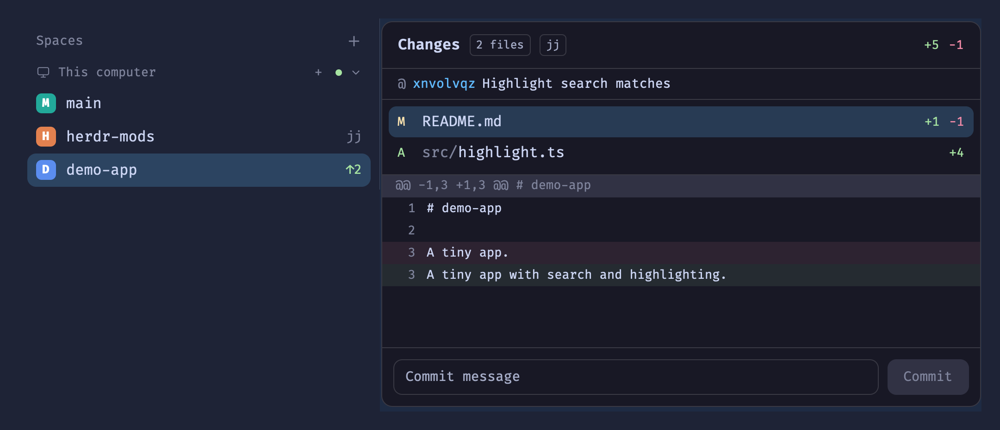

# Jujutsu Changes

The Changes panel for Jujutsu repos. Open it in a space whose terminal is in a jj repo and it lists what the working-copy change `@` changes, with each file's diff and a box to commit it with `jj commit`. Outside jj it is the shipped git Changes panel.

## What you see

- Header (42px): "Changes", a `N files` pill, a `jj` pill in jj repos, then `+add` (ansi2) and `−del` (ansi1) totals.
- jj only: a 28px row `@ <change id (accent)> <description, or "(no description)" dim>`, and a red `conflict` pill when `@` has conflicts.
- The file list (28px rows: status letter A/M/D/U, dim folder + name, +/- counts), the diff below it (20px rows, line numbers, green/red tints), and the commit input + button at the bottom, all exactly as the shipped `changes` mod.
- Empty states: "No changes in @" (jj), "No uncommitted changes" (git), "Not a git or jj repository".

## How it behaves

- Agent statuses play no part.
- Click a file to show its diff, click again to close it. The first file opens by itself.
- Commit (Enter or the button): jj → `jj commit -m <message>` (describe `@`, start a new empty change); git → `git add -A && git commit -m`.
- Refreshes when the focused pane's folder changes, every 10 s, and on folder changes in the repo (not on its own `.jj/` / `.git/` writes).

## Built from

- `mod.clone {"name":"changes","as":"jj-changes"}`, then `main.js` edited. `mod.json`: `{"place":"none"}` plus `cloned_from`.
- `herdr`: `spaces`, `panes`, `focused`, `exec`, `readTextFile`, `watchFolder`, `theme`, `settings`.
- Programs: `jj` (`root`, `log -r @ -T …`, `diff --git`, `resolve --list`, `commit`), `git` as shipped.
- Status template: `change_id.shortest(8) ++ "\t" ++ if(conflict,"1","0") ++ "\t" ++ description.first_line() ++ "\n" ++ self.diff().stat().files().map(|f| f.status_char() ++ "\t" ++ f.lines_added() ++ "\t" ++ f.lines_removed() ++ "\t" ++ f.path()).join("\n")`.
- Left bar: `spaces-icons.patch` adds `checkJj()` to a `spaces` clone: `heads(::@ & bookmarks())` → bookmark name; `heads(::@ & bookmarks())..@ ~ empty()` → ahead; else `@<shortest change id>`. All with `--ignore-working-copy`.
- Workspaces: `mod.clone {"name":"menu","as":"jj-menu"}`; its `checkout()` tries `jj --ignore-working-copy root` first and returns `jj-main` / `jj-linked` (`.jj/repo` is a file in an added workspace), whose space items open the `jj-workspace` dialog (`{space, action: "new"|"open"|"remove"}`, modelled on the shipped `worktree`). `spaces-icons`' `menu(w)` opens `jj-menu`.

## Watch out

- Shipped mods are replaced on start: never edit `changes` itself.
- jj commands without `--ignore-working-copy` snapshot and write under `.jj/` (and `.git/` when colocated); a watch that refreshes on those loops forever.
- Pass paths as `root-file:"<path>"`: a bare path is a fileset expression (spaces, parens, globs break it).
- `f.path()` is repo-relative regardless of cwd.
- `jj git init` colocates by default now; test jj-only repos with `--no-colocate`.
- A secondary workspace's `.jj/repo` pointer is relative to its `.jj/` folder.
- `jj workspace add -r` takes a revset: quote bookmark names (`"feat/x"`).
- The CLI can't pass props to an overlay: without props `jj-workspace` opens the list for the shown space, which is how it's tested (`mod.open`).

## Installing into someone's setup

For the agent asked to add this mod. Before you start, tell the person that the mods run `jj` and `git` (`exec`, in the space's folder, also on other machines). They read files only inside repos. Nothing reaches the network. `jj` must be on the PATH of each machine where they want jj support; anywhere else the mods behave like Herdr's shipped ones.

1. **Mods.** Copy `mods/jj-changes`, `mods/jj-menu` and `mods/jj-workspace` into `~/.config/herdr-app/mods/`. Copy them, don't symlink: Herdr doesn't hot-reload a symlinked mod. If one of those names is taken, stop and ask.
2. **Layout: the Changes panel.** The mod shows nowhere until a layout names it.
   - The shown layout is `"layout"` in `herdr-app status`. A shipped one (`main`, `terminals`, `win98`: listed as `layout:<name>` in `installed.json`) is read-only. Clone it with `herdr-app do layout.clone '{"name":"<name>","as":"<name>-jj"}'`; that also switches to the clone. Then edit the clone.
   - In `layouts/<name>.json`, find the block whose `content.mod` is `"changes"`. Change only that value to `"jj-changes"`. Keep its `id` (usually `"changes"`): the tab bar's Changes button opens the block by that id. A layout without such a block, like `terminals`, gets none; say so instead of adding one.
   - Ask whether to do the same in the person's other layouts.
3. **Sidebar: bookmarks, and jj workspaces on right-click.** Find the block in that layout whose mod draws the spaces list (`content.mod` of the `spaces` node).
   - If it is the shipped `spaces`, clone it first: `herdr-app do mod.clone '{"name":"spaces","as":"spaces-jj"}'`. Point that block's `content.mod` at the clone.
   - If it is already the person's own clone (its `mod.json` has `cloned_from: {name: "spaces"}`), patch it in place, after asking.
   - Patch: `patch <mods>/<sidebar>/main.js < spaces-icons.patch` (name the file: the patch's own paths say `spaces-icons/`). Use `--dry-run` first. On a clone of the shipped `spaces` (0.1.14), hunks 3–5 apply and two fail. Do those two by hand:
     - **Hunk 1** (the `from "herdr"` import): add `readTextFile` to that clone's own import list. Leave the rest of the line as it is.
     - **Hunk 2** (`roots()`): only exists in clones that look up project icons. If there is no `roots()`, skip it. If there is, make its repo-path `replace` also strip `/.jj/repo`.
   - Delete any `.rej` / `.orig` files `patch` leaves behind.
   - The three changes that matter:
     - `checkJj()` is defined, and `check()` calls it first;
     - `menu(w)` opens `"jj-menu"`;
     - `readTextFile` is imported.
     Read the result to confirm all three.
4. **Check.** Run `herdr-app check` on each mod you added or changed. `herdr-app status` must show `"errors": []`. Then work through *Done when* in a jj repo of theirs. Don't commit anything in it: use a throwaway repo (`jj git init`) for Commit and the workspace actions.
5. **Leave alone.** The tab bar's **+** menu (shipped `new-menu`) keeps its git worktree items. Changing it would mean patching the tab bar mod too, which this mod doesn't do.

Undo: point the layout block back at `"changes"`, reverse the patch (`patch -R`), or put the sidebar block back on the original mod. Then delete the three `jj-*` folders.

## Done when

- `herdr-app check` passes for `jj-changes` and the patched spaces mod; `herdr-app status` shows no errors.
- In a jj repo with edits, the panel shows the `jj` pill, `@ <id>`, every changed file with counts, and a diff.
- Commit leaves `@-` described and an empty `@`; the panel empties.
- A plain git repo looks and behaves like the shipped panel.
- With the panel open and nothing changing, `jj op log` doesn't grow.
- A colocated jj space in the left bar shows its bookmark and `↑N`, not `detached`.
- Right-clicking a jj space shows New/Open jj workspace (Remove jj workspace in an added one); a git space shows the worktree items.
- `mod.open jj-workspace` on a jj space lists every workspace, the main one first, with "open" on the shown one.
